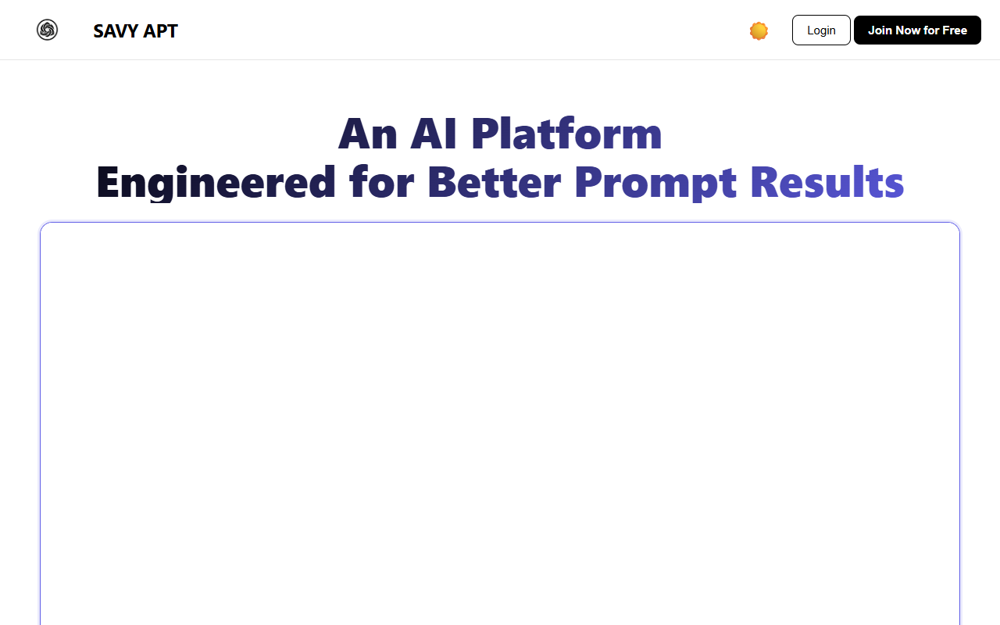
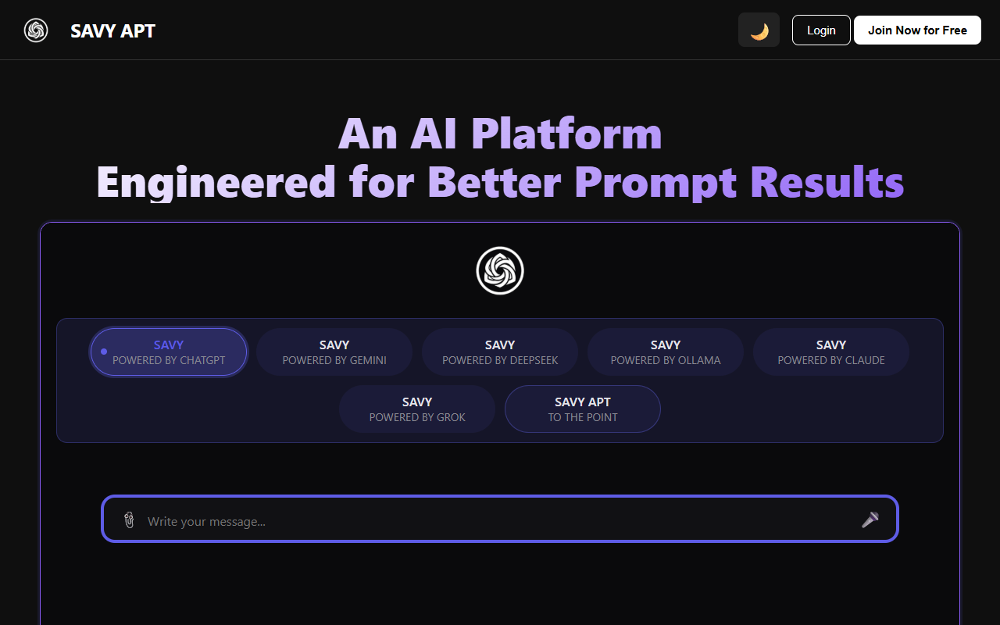
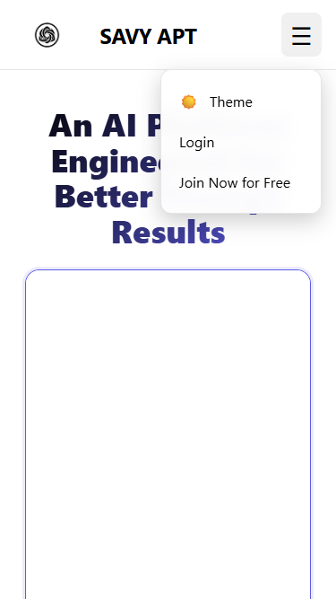
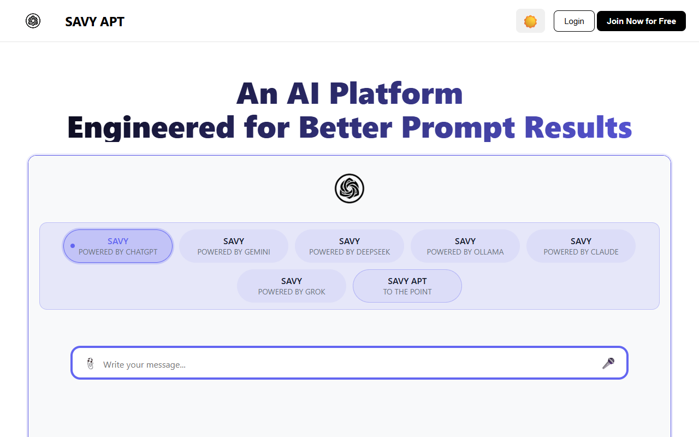
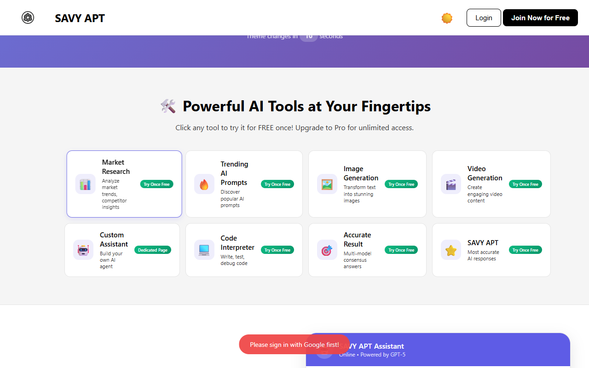
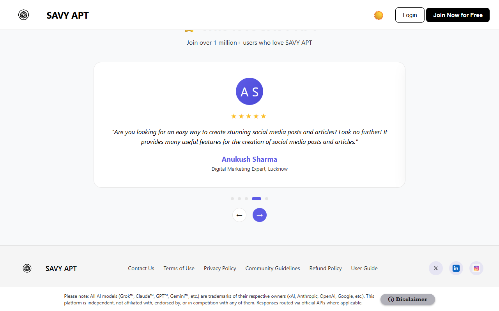
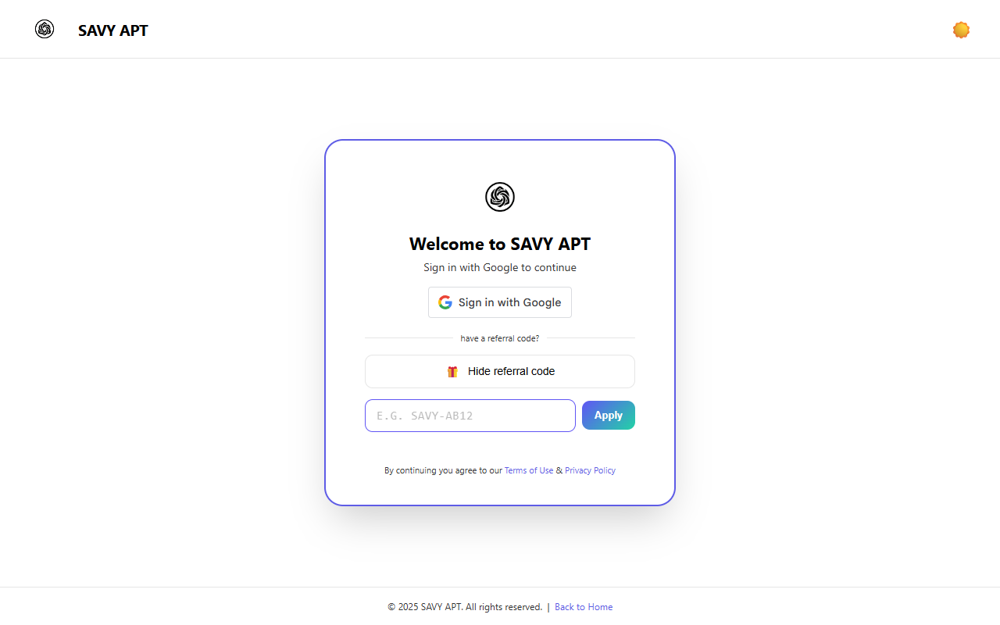
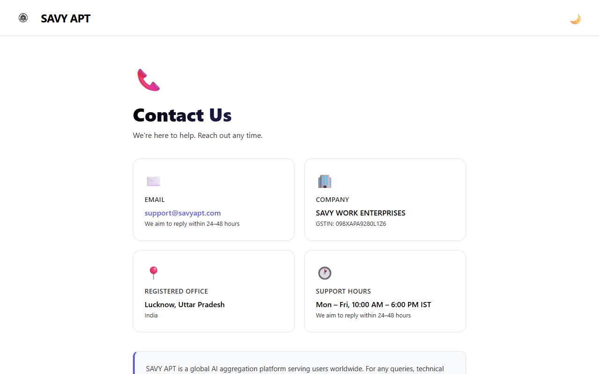

# SAVY APT – Web Application Testing & QA Portfolio Project


-success)


## 📌 Project Overview
This repository contains an end-to-end, industry-standard **Software Testing and Quality Assurance (QA)** portfolio project for the public web application **SAVY APT** ([https://savyapt.com/](https://savyapt.com/)). 

Developed as a submission for a **Trainee – Software Testing** role, this project demonstrates practical, production-grade proficiency across the full Software Testing Life Cycle (STLC), including:
- **Architectural & Functional Surface Analysis** (`WEBSITE_ANALYSIS.md`)
- **Formal Test Planning & Test Scenario Matrix** (`test-plan/`)
- **Exhaustive Manual Test Design** (70 RFC 4180 CSV & Markdown test cases across 25 focus areas)
- **Live Test Execution & Evidence Capture** (69 Passed, 1 Blocked by design, 0 Failed, 12 verified PNG screenshots)
- **End-to-End Automated Regression Testing** (34 atomic Playwright test specs running across Desktop, Tablet, and Mobile viewports)
- **Standardized Defect Management** (`bug-reports/`)

---

## 🎯 Application Under Test (AUT)
- **Platform Name:** SAVY APT
- **URL:** [https://savyapt.com/](https://savyapt.com/)
- **Product Domain:** Generative AI tools directory, prompt auto-rotation discovery, interactive embedded chat interfaces, custom AI assistant workflows, and creator referral programs.
- **Testing Approach:** Strict adherence to live public features. Authenticated/paid workflows (e.g. Google OAuth sign-in, payment processing) are strictly gated and verified as `Blocked (Authentication Required)` rather than simulated or bypassed.

---

## 📂 Repository Structure

```text
Trainee-Software-Testing/
├── WEBSITE_ANALYSIS.md            # Comprehensive architectural & public route breakdown
├── README.md                      # Project master documentation & portfolio overview
├── .gitignore                     # Git ignore rules for node_modules, reports & temp files
├── test-plan/
│   ├── test-plan.md               # Formal Master Test Plan (Scope, strategy, risks, criteria)
│   └── test-scenarios.md          # High-level test scenario to test case traceability matrix
├── test-cases/
│   ├── manual-test-cases.csv      # 70 formal test cases in RFC 4180 CSV format (13 columns)
│   ├── manual-test-cases.md       # Human-readable Markdown catalog of all 70 test cases
│   ├── smoke-test-cases.md        # 15 critical-path smoke tests for rapid build verification
│   └── regression-checklist.md    # 65-point release candidate regression verification checklist
├── test-results/
│   └── test-execution-report.md   # Complete execution report with live metrics and findings
├── bug-reports/
│   └── bug-report-template.md     # Standardized defect logging template (IEEE 829 compliant)
├── screenshots/                   # 12 real, timestamped test execution visual evidence files
│   ├── TC-001-homepage.png
│   ├── TC-015-dark-mode.png
│   ├── TC-024-mobile-menu.png
│   ├── TC-028-faq.png
│   ├── TC-037-tool-toast.png
│   ├── TC-045-testimonial.png
│   ├── TC-049-login.png
│   ├── TC-053-referral-accordion.png
│   ├── TC-059-custom-assistant.png
│   ├── TC-063-contact.png
│   ├── TC-067-responsive-mobile.png
│   └── TC-068-responsive-tablet.png
└── automation/
    ├── package.json               # Node.js dependencies (@playwright/test)
    ├── playwright.config.js       # Playwright multi-viewport & reporter configuration
    ├── README.md                  # Automation framework guide & execution instructions
    ├── test-results-summary.md    # Specification-by-specification automation breakdown
    └── tests/
        ├── homepage.spec.js       # 5 tests: branding, hero, tickers, category chips
        ├── navigation.spec.js     # 5 tests: header links, footer routing, external links
        ├── theme.spec.js          # 4 tests: dark/light mode toggle & persistence
        ├── faq.spec.js            # 5 tests: accordion expansion, collapse & keyboard a11y
        ├── mobile.spec.js         # 5 tests: hamburger menu, mobile drawer, touch links
        ├── tools.spec.js          # 5 tests: tool cards, categories, auth toast gate
        └── responsive.spec.js     # 5 tests: desktop, tablet, and mobile viewport layouts
```

---

## 📊 Test Execution Summary

### Manual Test Execution (Live AUT)
| Metric | Count | Percentage |
|---|---|---|
| **Total Test Cases** | 70 | 100% |
| **Passed** | 69 | 98.6% |
| **Blocked (Auth Required)** | 1 | 1.4% |
| **Failed** | 0 | 0.0% |
| **Not Executed** | 0 | 0.0% |
| **Identified Defects** | 0 | 0 |

> **Note on Blocked Test:** `TC-062` (Custom Assistant deployment) correctly requires Google OAuth authentication and an active paid plan. In accordance with professional QA standards, this was marked `Blocked (Authentication Required)` without fabricating test results or bypassing security gates.

### Automated Test Execution (Playwright E2E)
| Metric | Count | Percentage |
|---|---|---|
| **Total Automated Tests** | 34 | 100% |
| **Passed** | 34 | 100% |
| **Failed** | 0 | 0.0% |
| **Flaky / Retried** | 0 | 0.0% |
| **Execution Duration** | ~1.4 minutes | Fast feedback |

---

## 🧪 Test Coverage Matrix

The test suite systematically exercises 25 distinct QA disciplines:
1. **Smoke Testing**: Critical path sanity checks (`smoke-test-cases.md`)
2. **Homepage Functional**: Hero elements, branding, tagline visibility
3. **Desktop Navigation**: Header links, active states, direct routing
4. **Header & Footer**: Social links, copyright validation, secondary links
5. **Login / Authentication Gates**: Redirection to `login.html`, OAuth prompt verification
6. **Referral Program**: Tier breakdowns, rewards calculator UI, toggle accordions
7. **Custom Assistant**: Promotional workflows, features list, gated deployment
8. **AI Tool Directory**: Category filtering, tag indicators, card grids
9. **FAQ Accordion**: Single and multi-expand collapsible behavior
10. **Theme Switcher**: Dark/Light mode DOM attribute mutation (`data-theme`)
11. **Mobile Drawer Menu**: Hamburger animation, backdrop dismissal, mobile links
12. **Category Prompt Filters**: Filter chip activations and DOM state updates
13. **Prompt Auto-Rotation**: Dynamic cycling of sample prompts
14. **Testimonials Carousel**: 8-second auto-rotation and manual dot selection
15. **Contact Page**: Field input acceptance and routing
16. **Legal & Policy Pages**: Privacy, Terms, and Security route availability (HTTP 200)
17. **Chat Interface**: Hero iframe embedding with redirect suppression
18. **Form Validation**: HTML5 constraints, email regex, required field checks
19. **Negative Testing**: Blank submissions, invalid email syntax, rapid clicks
20. **Boundary Testing**: Maximum length inputs in contact fields
21. **Responsive Testing**: Multi-viewport rendering (375px, 768px, 1280px)
22. **Accessibility (a11y)**: Focus indicators, semantic tags, ARIA states
23. **Error Handling**: Graceful client handling for unauthenticated actions
24. **Link Validation**: Zero broken links across public routing table
25. **Regression Testing**: 65-item release candidate checklist (`regression-checklist.md`)

---

## 📖 How to Review & Navigate the Deliverables

For hiring managers, QA leads, and evaluators reviewing this repository, the artifacts are structured for sequential evaluation:

| Evaluation Step | Recommended Artifact | Key Information Provided |
|---|---|---|
| **1. System Understanding** | [`WEBSITE_ANALYSIS.md`](./WEBSITE_ANALYSIS.md) | Verified public routes, UI components, DOM attributes, and access constraints. |
| **2. Test Strategy** | [`test-plan/test-plan.md`](./test-plan/test-plan.md) | Objectives, scope, entry/exit criteria, environments, risks, and STLC approach. |
| **3. High-Level Traceability** | [`test-plan/test-scenarios.md`](./test-plan/test-scenarios.md) | 14 functional scenarios mapped to specific test cases and execution statuses. |
| **4. Test Case Design** | [`test-cases/manual-test-cases.md`](./test-cases/manual-test-cases.md) | Full 70-test catalog with preconditions, steps, test data, expected and actual results. |
| **5. Test Data Interchange** | [`test-cases/manual-test-cases.csv`](./test-cases/manual-test-cases.csv) | Machine-readable, RFC 4180 CSV export ready for import into Jira, TestRail, or Zephyr. |
| **6. Fast Verification** | [`test-cases/smoke-test-cases.md`](./test-cases/smoke-test-cases.md) | 15 critical smoke tests for build acceptance. |
| **7. Release Confidence** | [`test-cases/regression-checklist.md`](./test-cases/regression-checklist.md) | 65 regression checklist items categorized across 11 functional modules. |
| **8. Execution Evidence** | [`test-results/test-execution-report.md`](./test-results/test-execution-report.md) | Executive summary, live execution metrics, zero-bug verification, and screenshots index. |
| **9. Defect Management** | [`bug-reports/bug-report-template.md`](./bug-reports/bug-report-template.md) | Standardized defect reporting schema ready for bug triage. |
| **10. Visual Proof** | [`screenshots/`](./screenshots/) | 12 timestamped visual artifacts validating execution states on Chrome. |
| **11. Test Automation** | [`automation/`](./automation/) | 34 automated Playwright E2E tests running across Desktop, Tablet, and Mobile viewports. |

---

## 🚀 How to Run the Automated Suite

### 1. Prerequisites
- [Node.js](https://nodejs.org/) (v18.x or v20.x+)
- Google Chrome or Chromium

### 2. Setup
```bash
# Clone the repository
git clone https://github.com/ayushgupta-120/Trainee-Software-Testing.git
cd Trainee-Software-Testing/automation

# Install Playwright dependencies
npm install
```

### 3. Run Tests
```bash
# Run all 34 automated E2E tests headlessly
npx playwright test

# Run tests with visible browser window (headed)
npx playwright test --headed

# Run a specific test suite
npx playwright test tests/homepage.spec.js

# Generate and view interactive HTML report
npx playwright show-report
```

---

## 📸 Visual Evidence Gallery

| Homepage (TC-001) | Dark Mode Switcher (TC-015) |
|:---:|:---:|
|  |  |

| Mobile Navigation (TC-024) | FAQ Accordion (TC-028) |
|:---:|:---:|
|  |  |

| Auth Toast on Tool Card (TC-037) | Testimonials Carousel (TC-045) |
|:---:|:---:|
|  |  |

| Referral Accordion (TC-053) | Contact Us Validation (TC-063) |
|:---:|:---:|
|  |  |

---

## 💡 Key QA Insights & Engineering Observations
1. **Graceful Authentication Protection**: When unauthenticated users click any tool card in the AI directory, the application non-disruptively renders a floating toast (`#toolUsagePopup`) stating *"Please sign in with Google first!"* before redirecting to `login.html` after an 800ms delay.
2. **Iframe State Parameter Isolation**: The standalone route `chat.html` immediately enforces authentication redirects. However, within the public homepage hero section, it is safely embedded via `chat.html?embed=true&hideSidebar=true`, setting `window.__EMBED__ = true` to allow public visitors to interact with sample prompts without disruption.
3. **High Code Quality & Zero Defects**: The public application demonstrated robust DOM handling, zero broken links, responsive layout fluidity down to 375px mobile screens, and full compliance with HTML5 form validation rules.

---

## 👤 Author
- **Name:** Ayush Gupta
- **Role:** Trainee – Software Testing
- **GitHub:** [@ayushgupta-120](https://github.com/ayushgupta-120)
- **Profile:** [https://github.com/ayushgupta-120](https://github.com/ayushgupta-120)
